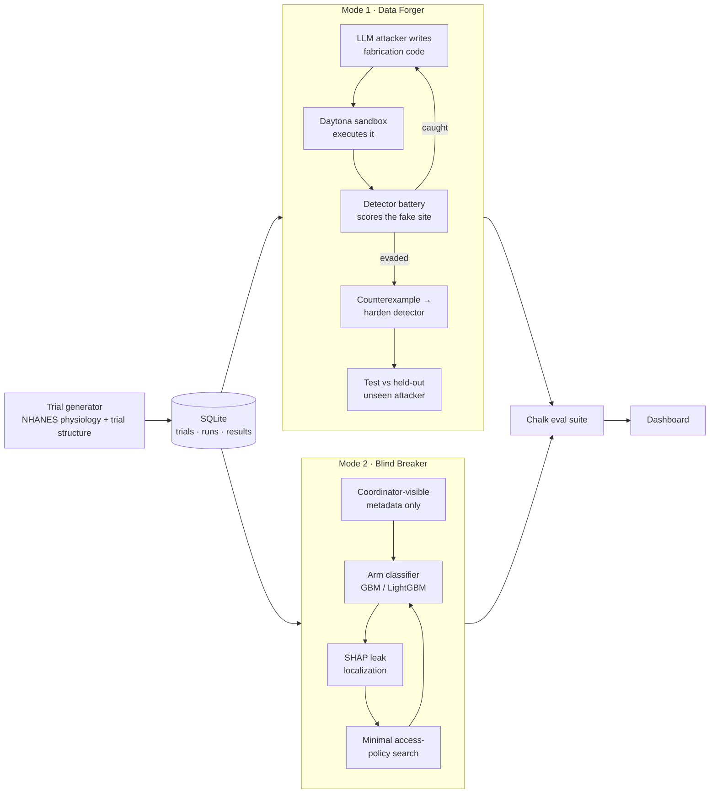

# Probe

**Penetration testing for clinical trials.**

Probe is an adversarial testing platform for clinical-trial integrity. It attacks the two assumptions every trial relies on, **the data is real** and **the blind holds**, before the trial launches. Then it hardens the defenses and checks that the fixes still hold against attackers they have never seen.

> **Probe never touches, edits, or "cleans up" medical data.** It hardens the *fraud detector* and the *access rules*. The data stays untouched.

Built at HackHarvard 2026 for the Regeneron track.

---

## Why

A trial's result only means something if two things are true:

1. **Every site's data is real.** Sites send patient data to a central team. If one site fabricates records (for payment, to look productive, or through misconduct), the trial's conclusion is wrong.
2. **Blinded staff can't tell who got the drug.** If coordinators can work out who is on treatment, even by accident, their expectations can bias the outcome.

Both assumptions fail in practice, and neither is stress-tested before launch. Fraud is usually caught afterward, if it is caught at all. Blinding is usually checked afterward too, by asking staff to guess, and most papers don't report a blinding check at all.

The threat is also growing. Taloni et al. (2025, *JAMA Ophthalmology*) showed that a custom GPT could refine fabricated medical datasets until some of them passed forensic fraud analysis as authentic. AI-generated fake trial data that beats the checks has already been demonstrated.

## What Probe does

One adversarial engine with two attack modes, run over the same semi-synthetic trial dataset.

### Mode 1 — Data Forger

An attacker agent writes code that fabricates an entire site's patient data. It runs that code, reads the fraud detector's verdict, and rewrites the code until the fake site gets through.

The new part is the loop around it:

1. Every forgery that gets past the detector becomes a counterexample.
2. The detector is retrained on those counterexamples.
3. The retrained detector is tested against a **new attacker strategy it never trained on**.

That held-out test shows the detector learned something general instead of memorizing one fake. It is also the step earlier work skipped.

### Mode 2 — Blind Breaker

An attacker sees **only** the metadata a blinded coordinator is allowed to see: visit schedules, lab routing, inventory events, and follow-up counts. From that, it tries to predict each patient's treatment arm.

If it beats chance, operational details are leaking the treatment assignment. Probe then:

1. Uses SHAP to find which fields leak the arm.
2. Searches for the **smallest access-policy change** that pushes the attacker back to chance.
3. Checks that the coordinator can still do their job with the restricted view.

### One idea behind both modes

Both modes test the same thing: **can an adversary infer something it shouldn't, from only what it's allowed to see?**

| | Data Forger | Blind Breaker |
|---|---|---|
| **Protected property** | Whether a site is fabricated | A patient's treatment assignment |
| **Adversary** | A fabricator trying to pass as authentic | A coordinator trying to infer the arm |
| **What the adversary sees** | The submitted trial records | Coordinator-visible metadata |
| **Attack metric** | Evasion / false-negative rate | Treatment-inference accuracy (AUC) |
| **Defense** | Harden the monitoring model | Tighten the access / redaction policy |
| **Constraint** | Must not start flagging legitimate sites | Must not destroy operational utility |

Both follow the same cycle: **attack → exploit → patch → verify.**

---

## Architecture



### The semi-synthetic trial

We know the ground truth exactly because we planted it. That's what makes every before/after number measurable.

```
realistic patient physiology    (NHANES — real, public, measured data)
      ↓ randomized treatment assignment
      ↓ site allocation
      ↓ longitudinal visits
      ↓ labs / adverse events
      ↓ operational metadata
```

- **Fraud** is planted at known sites with known methods, so detection can be scored honestly.
- **Blinding leaks** come from documented causal mechanisms rather than planted correlations. For example, a drug side effect leads to more adverse-event follow-up visits.

### Detector battery (Forger target)

- Terminal-digit preference
- Variance tests (fabricated data tends to be too uniform)
- Correlation structure between related measurements
- Mixed-effects site-level model

---

## Evaluation

Every claim is backed by a reproducible eval suite that runs on Chalk:

| Metric | Measures |
|---|---|
| `fraud_evasion_rate` | How often a fabricated site gets past the detector |
| `legitimate_false_positive_rate` | How often the detector flags real sites (should stay low) |
| `unblinding_accuracy` / AUC | How well the Blind Breaker predicts the arm |
| `operational_utility_retained` | How much of the coordinator's job still works after the policy fix |
| `generalization_to_held_out_attack` | **The credibility metric:** detector performance against an attacker it never trained on |

**Demo targets** (goals, not results yet):

- Forger evasion against an unseen attacker: ~68% → single digits, with no rise in false positives on legitimate sites.
- Blind Breaker accuracy: ~86% → ~51% (about chance), with ~94% operational utility kept.

---

## Tech stack

| Layer | Tools |
|---|---|
| Core | Python 3.11, pandas, NumPy |
| Models | scikit-learn (gradient boosting), XGBoost / LightGBM |
| Statistics | SciPy, statsmodels (forensic checks, mixed-effects model) |
| Explainability | SHAP |
| Data | NHANES; CDISC SDTM/ADaM pilot data (optional, depending on usage terms) |
| Sandboxing | [Daytona](https://www.daytona.io/) |
| Evals | [Chalk](https://chalk.ai/) |
| Attacker reasoning | LLM API (Claude), routed through Chalk's gateway |
| Storage | SQLite |
| UI | Streamlit / Gradio |
| Optional | Factory Droid writes new detector rules when a forgery escapes |

### How the sponsor tools are used

- **Daytona** runs the code the Forger agent writes, which is untrusted, inside isolated sandboxes. Its **fork** feature snapshots a trial episode and replays it with and without the defense, side by side.
- **Chalk** is the evaluation layer for both modes. It produces the reproducible numbers behind "the defense got better."
- **Factory Droid** (optional) writes the new detector rule that catches an escaped forgery, inside the running loop.

---

## Repository layout (planned)

```
probe/
├── probe/
│   ├── generator/      # semi-synthetic trial generator (NHANES base → trial)
│   ├── forger/         # attacker agent, Daytona runner, co-evolution loop
│   ├── detectors/      # fraud detector battery
│   ├── breaker/        # arm classifier, SHAP localization, policy search
│   ├── evals/          # Chalk eval suite
│   └── db.py           # SQLite persistence
├── app/                # dashboard
├── data/               # NHANES pulls, generated trials (gitignored)
├── seeds/              # deterministic demo seeds
└── tests/
```

## Getting started

> The project is in early development. Setup steps will firm up as the code lands.

```bash
git clone https://github.com/garvnn/probe.git
cd probe
python3.11 -m venv .venv && source .venv/bin/activate
pip install -r requirements.txt
cp .env.example .env    # add DAYTONA_API_KEY, CHALK credentials, ANTHROPIC_API_KEY
```

---

## Team

| Role | Owns |
|---|---|
| **P1 — Data & Trial Generator** | Credibility: NHANES base, trial structure, planted fraud, causal leak mechanisms |
| **P2 — Forger Loop** | The core loop: detector battery, attacker agent, escape → harden → held-out test, Daytona |
| **P3 — Blind Breaker + Dashboard** | Arm attacker, SHAP, minimal policy search, the UI |
| **P4 — Evals, Pitch & Video** | Chalk eval harness, demo script, Q&A prep, content |

## Principles

1. **The Forger loop is the priority.** If time runs short, simplify the Blind Breaker, never the loop.
2. **The held-out number is what makes the result credible.** It has to be real, and it has to be visible.
3. **We harden the detector and the access rules, never the data.**
4. **Finishing beats features.** A working single-mode demo beats a broken two-mode one.

## Responsible use

Probe is a defensive tool. Its attackers exist to find weaknesses in fraud monitoring and blinding controls so those weaknesses can be fixed before a real trial depends on them. Probe runs only on semi-synthetic data, and forged output never leaves the sandbox.
